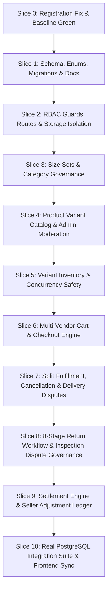

# Backend Refactoring Implementation Plan (SRS v1.2)

**Document:** Implementation Fix Plan  
**Target:** NestJS + Fastify + Prisma Backend (`/backend`)  
**Single Source of Truth:** `docs/SRS.md` (v1.2)  
**Supporting Documents:** `docs/Entities/*`, `docs/api/*`, `docs/database-design.md`, `docs/business-workflows.md`, `docs/architecture.md`, `AGENTS.md`  
**Date:** 2026-10-14  
**Status:** Ready for Execution (Awaiting "continue")  

---

## 1. Executive Summary & Strategy

The backend audit ([backend-audit.md](file:///d:/MarketPlace/Marketplace/docs/audit/backend-audit.md)) revealed critical divergences between the current codebase and SRS v1.2:
1. **Broken Registration & Auto-Activation Bypass:** Fails test suite and bypasses mandatory email verification.
2. **Missing Product Variant & Size Set Architecture:** Products are modeled with flat prices, single SKUs, and product-level inventory; Size $\times$ Color variants and data-driven Size Sets do not exist.
3. **Enum Divergence:** Schema enums include non-spec statuses (`PENDING`, `CONFIRMED`, `PROCESSING`, `DELETED`, `COMPLETED`) instead of strict SRS Section 8 enumerations in `UPPER_SNAKE_CASE`.
4. **Settlement Architecture Incompleteness:** Lacks the `SellerAdjustment` shortfall debit ledger, negative balance ₹0 floor, dispute chargeback mechanics, and the separation of `SettlementBatchStatus` vs `SettlementItemStatus`.
5. **Security & Route Defects:** RolesGuard allows unauthenticated/wrong-role access to seller endpoints; 4 controllers double-prefix routes (`/api/v1/api/v1`).
6. **Concurrency Vulnerability:** Inventory reservation uses an un-isolated read-modify-write cycle.
7. **Storage Isolation Failure:** Tests write files directly into `backend/storage_private`.

To guarantee zero regression and seamless transition, the refactoring is broken down into **10 structured, verifiable slices**. Each slice concludes with passing tests, git status review, and a checkpoint.

---

## 2. Global Architectural Decisions & Conventions

### 2.1 Enum Naming Convention
Every Prisma enum value represents the SRS Section 8 label converted to `UPPER_SNAKE_CASE` (spaces and hyphens become underscores). All non-SRS values are deleted.

| Enum Name | SRS Section | Permitted Database Values |
|---|---|---|
| `SellerStatus` | Section 8.6 | `PENDING_APPROVAL`, `APPROVED`, `REJECTED`, `SUSPENDED`, `BLOCKED` |
| `ProductStatus` | Section 8.7 | `ACTIVE`, `PAUSED`, `HIDDEN`, `SOFT_DELETED`, `REMOVED_BY_ADMIN` |
| `SellerCategoryStatus` | Section 8.8 | `REQUESTED`, `APPROVED`, `REJECTED`, `REVOKED` |
| `OrderItemStatus` | Section 8.1 | `PLACED`, `PACKED`, `SHIPPED`, `DELIVERED`, `CANCELLED`, `NOT_RECEIVED_UNDER_DISPUTE` |
| `OrderStatus` | Section 8.2 | `PLACED`, `PARTIALLY_SHIPPED`, `PARTIALLY_DELIVERED`, `DELIVERED`, `PARTIALLY_CANCELLED`, `CANCELLED`, `UNDER_DISPUTE` |
| `ReturnRequestStatus` | Section 8.3 | `REQUESTED`, `APPROVED`, `REJECTED`, `IN_TRANSIT`, `RECEIVED`, `VERIFIED`, `REJECTED_ON_INSPECTION`, `REFUNDED` |
| `PaymentStatus` | Section 8.4 | `PENDING`, `PAID`, `FAILED`, `PARTIALLY_REFUNDED`, `REFUNDED` |
| `SettlementItemStatus` | Section 8.5 | `NOT_ELIGIBLE`, `ELIGIBLE`, `SETTLED` |
| `SettlementBatchStatus` | Section 8.5 (New) | `GENERATED`, `APPROVED`, `SETTLED`, `CANCELLED` |
| `DisputeResolutionOutcome` | Section 8.1 / FR-9 | `CUSTOMER_REFUND_UPHELD`, `DISPUTE_REJECTED` |

### 2.2 Product Catalog & Inventory Structural Changes
1. **Remove `Product.sku`**: Globally unique SKU exists exclusively on `ProductVariant.sku`.
2. **Remove `Product.inventory`**: Inventory is tracked exclusively per `ProductVariant`.
3. **Compound Unique Constraint**: `@@unique([productId, size, color])` on `ProductVariant`.
4. **Mandatory `OrderItem.variantId`**: Every purchased line item points to a `ProductVariant`.
5. **`ProductImage.variantId`**: Nullable foreign key allowing images per product and per variant.

### 2.3 Settlement Batch & Debit Ledger Rules
1. `SettlementBatchStatus`:
   - `GENERATED`: Batch calculated and previewed by Super Admin.
   - `APPROVED`: Super Admin approved figures for payment.
   - `SETTLED`: Super Admin entered external bank transaction reference; permanently immutable.
   - `CANCELLED`: Batch discarded; returns linked items to `ELIGIBLE`.
2. Negative calculated payouts are floored at ₹0.00. The shortfall is recorded as a `SETTLEMENT_SHORTFALL_DEBIT` in `SellerAdjustment` and carried forward.
3. Third-party sellers only; Super Admin direct sales incur 0% commission and are excluded from settlements.

---

## 3. Step-by-Step Slice Implementation Roadmap



---

### Slice 0: Registration Fix & Baseline Test Suite Green
**Goal:** Fix the 2 failing authentication tests, remove the illicit auto-activation bypass, establish a clean green test baseline, and setup ESLint flat config.

- **Changes:**
  1. `src/auth/auth.service.ts`:
     - Remove `shouldAutoActivate`.
     - User registration always assigns `accountStatus: AccountStatus.PENDING`, `emailVerified: false`, generates email verification token hash and expiration.
     - Always dispatches `emailService.sendVerificationEmail`.
     - Returns `{ userId, status: AccountStatus.PENDING, message: 'Verification instructions have been sent.' }`.
  2. Create `backend/eslint.config.js` compatible with ESLint 9 flat configuration so `npm run lint` succeeds.
  3. Verify test suite: `npm test` must report 26 suites passed, 121 tests passed, 0 failures.
- **Verification:** `npm test`, `npm run lint` (no `--fix`), `npm run build`.
- **Commit:** `fix(auth): enforce pending registration status and email verification`

---

### Slice 1: Database Schema, Enums, Migrations & Spec Sync
**Goal:** Align `prisma/schema.prisma` with SRS Section 8 enums and structural requirements, update supporting documentation, and create a migration.

- **Database Safety Notice:**
  - Before applying migration: Print `DATABASE_URL` with password masked. Confirm host is `localhost` or `127.0.0.1`.
  - Destructive reset (`prisma migrate dev` / `prisma db push`) only executed after user approval on local dev database.
- **Changes in `prisma/schema.prisma`:**
  1. Replace enums:
     - `SellerStatus`: `PENDING_APPROVAL`, `APPROVED`, `REJECTED`, `SUSPENDED`, `BLOCKED`.
     - `ProductStatus`: `ACTIVE`, `PAUSED`, `HIDDEN`, `SOFT_DELETED`, `REMOVED_BY_ADMIN`.
     - `SellerCategoryStatus`: `REQUESTED`, `APPROVED`, `REJECTED`, `REVOKED`.
     - `OrderItemStatus`: `PLACED`, `PACKED`, `SHIPPED`, `DELIVERED`, `CANCELLED`, `NOT_RECEIVED_UNDER_DISPUTE`.
     - `OrderStatus`: `PLACED`, `PARTIALLY_SHIPPED`, `PARTIALLY_DELIVERED`, `DELIVERED`, `PARTIALLY_CANCELLED`, `CANCELLED`, `UNDER_DISPUTE`.
     - `ReturnRequestStatus`: `REQUESTED`, `APPROVED`, `REJECTED`, `IN_TRANSIT`, `RECEIVED`, `VERIFIED`, `REJECTED_ON_INSPECTION`, `REFUNDED`.
     - `PaymentStatus`: `PENDING`, `PAID`, `FAILED`, `PARTIALLY_REFUNDED`, `REFUNDED`.
     - `SettlementItemStatus`: `NOT_ELIGIBLE`, `ELIGIBLE`, `SETTLED`.
     - `SettlementBatchStatus`: `GENERATED`, `APPROVED`, `SETTLED`, `CANCELLED`.
  2. Model updates:
     - `Product`: Drop `sku`, drop `inventory` relation.
     - `ProductVariant`: Add `@@unique([productId, size, color])`.
     - `OrderItem`: Make `variantId String @db.Uuid` mandatory.
     - `ProductImage`: Add `variantId String? @db.Uuid` with relation to `ProductVariant`.
     - `Settlement`: Update status to `SettlementBatchStatus @default(GENERATED)`.
     - `SettlementItem`: Add `status SettlementItemStatus @default(NOT_ELIGIBLE)`.
  3. Documentation updates:
     - Update `docs/SRS.md` Section 8 (add SettlementBatchStatus and UPPER_SNAKE_CASE naming rule).
     - Update `docs/Entities/29-Settlement.md` and `docs/Entities/30-Settlement-Item.md`.
     - Update `docs/database-design.md`.
- **Verification:** `npx prisma generate`, compile check.
- **Commit:** `feat(schema): normalize enums to SRS v1.2 and restructure product variants`

---

### Slice 2: RBAC Guards, Route Prefixing & Storage Isolation
**Goal:** Fix routing bugs, enforce role security across all endpoints, abstract file storage and email behind interfaces, and eliminate disk contamination during testing.

- **Changes:**
  1. Fix double prefix:
     - Remove `'api/v1'` parameter from `@Controller('api/v1')` in `ReturnRefundController`, `SettlementController`, `NotificationController`, `ReportingController`. (Global prefix `api/v1` handles all routing).
  2. RolesGuard hardening:
     - In `RolesGuard`, ensure that if `@Roles` is not declared on an endpoint or class with `@UseGuards(RolesGuard)`, it does **not** silently pass.
     - Add `@Roles('SELLER')` across all seller endpoints in `SellerController`, `ProductController`, `InventoryController`, `OrderController`, `SettlementController`, `ReturnRefundController`.
     - Add `@Roles('CUSTOMER')` across customer endpoints in `CustomerController`, `CartController`, `OrderController`, `ReturnRefundController`.
     - Add `@Roles('SUPER_ADMIN')` on all administrative endpoints.
     - Protect internal inventory endpoints (`/inventory/reservations`, etc.) with Super Admin guard or internal token.
  3. StorageService abstraction:
     - Define `IStorageService` interface.
     - Make `StorageService` read `STORAGE_BASE_DIR` from environment/ConfigService (fallback to local `./storage_private`).
     - Update `test/storage.service.spec.ts` and `test/seller-flow.integration.spec.ts` to write to `os.tmpdir()` and automatically clean up in `afterAll()`.
  4. EmailService abstraction:
     - Define `IEmailService` interface. Keep logger provider for local dev.
- **Verification:** Run tests, confirm zero files generated in `backend/storage_private`.
- **Commit:** `fix(security): harden rbac guards, fix route prefixes, and isolate storage service`

---

### Slice 3: Size Sets & Clothing Category Governance (FR-3, FR-4)
**Goal:** Implement data-driven Size Sets and subcategory bindings, and align seller category authorization with SRS Section 8.8 (`REQUESTED`, `APPROVED`, `REJECTED`, `REVOKED`).

- **Changes:**
  1. Super Admin Size Set Management:
     - Endpoints: `POST /api/v1/admin/size-sets`, `GET /api/v1/admin/size-sets`, `PATCH /api/v1/admin/size-sets/:id`, `POST /api/v1/admin/size-sets/:id/values`.
     - Seed defaults: Alpha (`XS-3XL`), Men's Waist (`28-42`), Women's Waist (`26-38`), Kids (`0-3M` to `12-13Y`), Free Size.
  2. Category binding:
     - Enforce that every subcategory must link to exactly one `sizeSetId`.
  3. Category authorization state machine:
     - Seller submits request $\to$ `REQUESTED`.
     - Admin approves $\to$ `APPROVED`, rejects with reason $\to$ `REJECTED`, revokes $\to$ `REVOKED`.
  4. Rewrite tests:
     - Rewrite [category.service.spec.ts](file:///d:/MarketPlace/Marketplace/backend/test/category.service.spec.ts) and [category-flow.integration.spec.ts](file:///d:/MarketPlace/Marketplace/backend/test/category-flow.integration.spec.ts) to test Size Sets and `REQUESTED` enum.
- **Verification:** Unit and flow integration tests pass.
- **Commit:** `feat(category): implement size sets management and update category authorization`

---

### Slice 4: Product Variant Catalog & Admin Moderation (FR-5, BR-3, BR-4)
**Goal:** Implement Product Variants (Size $\times$ Color), SKU uniqueness per variant, variant image binding, and Admin product takedown.

- **Changes:**
  1. Variant management endpoints:
     - `POST /api/v1/sellers/me/products/:productId/variants`
     - `PATCH /api/v1/sellers/me/products/:productId/variants/:variantId`
     - `DELETE /api/v1/sellers/me/products/:productId/variants/:variantId` (soft-delete if order history exists)
  2. Validation:
     - Variant size must be an active value in the subcategory's assigned `SizeSet`.
     - SKU must be globally unique across all variants.
     - Product-level pricing (Selling Price and Compare At Price) governs variants; optional nullable `priceOverride` column is supported but unused in V1 billing.
  3. Variant images:
     - Support associating `ProductImage` with a specific `variantId`.
  4. Admin moderation takedown:
     - `POST /api/v1/admin/products/:productId/takedown` with mandatory `takedownReason`. Status transitions to `REMOVED_BY_ADMIN`.
  5. Rewrite tests:
     - Rewrite [product.service.spec.ts](file:///d:/MarketPlace/Marketplace/backend/test/product.service.spec.ts) and [product-flow.integration.spec.ts](file:///d:/MarketPlace/Marketplace/backend/test/product-flow.integration.spec.ts) to test Size $\times$ Color variants, unique SKUs, and takedowns.
- **Verification:** Unit and flow integration tests pass.
- **Commit:** `feat(product): implement size-color variants, sku validation, and admin takedown`

---

### Slice 5: Variant Inventory & Concurrency Safety (FR-6, BR-5)
**Goal:** Track inventory strictly per `ProductVariant`, implement atomic stock deductions, and fix the overselling race condition.

- **Changes:**
  1. Variant inventory control:
     - Move stock management from product level to variant level (`variantId`).
     - Endpoints: `GET /api/v1/sellers/me/variants/:variantId/inventory`, `PATCH /api/v1/sellers/me/variants/:variantId/inventory`.
  2. Atomic Reservation & Concurrency:
     - Replace unprotected read-modify-write with atomic conditional SQL update inside transaction:
       ```sql
       UPDATE "Inventory" 
       SET "availableQuantity" = "availableQuantity" - :qty, 
           "reservedQuantity" = "reservedQuantity" + :qty 
       WHERE "variantId" = :variantId AND "availableQuantity" >= :qty
       ```
     - Throws `BadRequestException` if rows affected = 0.
  3. Out-of-stock dynamics:
     - Variant with stock = 0 marked out of stock.
     - When all variants of a product have stock = 0, catalog marks product out of stock.
  4. Rewrite tests:
     - Rewrite [inventory.service.spec.ts](file:///d:/MarketPlace/Marketplace/backend/test/inventory.service.spec.ts) and [inventory-flow.integration.spec.ts](file:///d:/MarketPlace/Marketplace/backend/test/inventory-flow.integration.spec.ts) for variant-level stock and concurrency.
- **Verification:** Concurrency simulation test passes.
- **Commit:** `feat(inventory): implement variant inventory with atomic reservation concurrency`

---

### Slice 6: Multi-Vendor Cart & Checkout Engine (FR-7, FR-8, FR-10)
**Goal:** Update cart and checkout to operate on `variantId`, snapshot variant attributes on order items, and verify payment webhook processing.

- **Changes:**
  1. Cart operations:
     - Add to cart accepts `variantId` (validates active status and variant stock).
     - Free shipping progress nudges grouped per seller.
  2. Order checkout transaction:
     - Atomic stock reservation per variant.
     - `OrderItem` creation snapshots: `variantId`, `skuSnapshot`, `sizeSnapshot`, `colorSnapshot`, `unitPrice`, `commissionRate`, `commissionAmount`, `shippingFeeShare`, and initial status `PLACED`.
  3. Payment confirmation:
     - Razorpay webhook confirms payment and transitions order/items to `PLACED` (or payment `PAID`).
  4. Rewrite tests:
     - Rewrite [cart.service.spec.ts](file:///d:/MarketPlace/Marketplace/backend/test/cart.service.spec.ts), [customer-cart-flow.integration.spec.ts](file:///d:/MarketPlace/Marketplace/backend/test/customer-cart-flow.integration.spec.ts), and [checkout-order-payment-flow.integration.spec.ts](file:///d:/MarketPlace/Marketplace/backend/test/checkout-order-payment-flow.integration.spec.ts).
- **Verification:** Cart and checkout integration tests pass.
- **Commit:** `feat(checkout): support variant cart items and snapshot pricing at checkout`

---

### Slice 7: Split Fulfillment, Cancellation & Delivery Disputes (FR-9, BR-9, AC-5)
**Goal:** Implement split order item fulfillment using SRS Section 8.1 statuses, pre-shipment customer/seller cancellation, and customer 7-day "Not received" dispute arbitration.

- **Changes:**
  1. Order item lifecycle:
     - Statuses: `PLACED` $\to$ `PACKED` $\to$ `SHIPPED` (requires courier & tracking AWB) $\to$ `DELIVERED`.
     - Parent order status dynamically derived per SRS Section 8.2 (`Placed`, `Partially Shipped`, `Partially Delivered`, `Delivered`, `Partially Cancelled`, `Cancelled`, `Under Dispute`).
  2. Cancellation:
     - Customer can cancel order items strictly before `SHIPPED`.
     - Automatic stock release / inventory restock.
     - Shipping fee retention on partial cancellation; full cancellation refunds shipping fee.
  3. "Not received" dispute workflow:
     - Customer reporting endpoint: `POST /api/v1/orders/:orderId/items/:orderItemId/not-received` (validated within 7 days of `deliveredAt`).
     - Item status transitions to `NOT_RECEIVED_UNDER_DISPUTE`. Parent order reflects `UNDER_DISPUTE`.
     - Seller attaches tracking proof: `POST /api/v1/sellers/me/orders/:orderId/items/:orderItemId/dispute-proof`.
     - Super Admin 3-business-day dispute arbitration endpoint: `POST /api/v1/admin/disputes/:orderItemId/arbitrate`:
       - `CUSTOMER_REFUND_UPHELD`: Triggers gateway refund; creates `DISPUTE_CHARGE_DEBIT` in `SellerAdjustment`.
       - `DISPUTE_REJECTED`: Closes dispute; item returns to settlement pipeline once 7-day post-delivery hold passes.
  4. Rewrite tests:
     - Rewrite [order.service.spec.ts](file:///d:/MarketPlace/Marketplace/backend/test/order.service.spec.ts).
- **Verification:** Order fulfillment, cancellation, and dispute tests pass.
- **Commit:** `feat(order): implement split fulfillment, cancellation, and 7-day delivery disputes`

---

### Slice 8: 8-Stage Return Workflow & Inspection Dispute Governance (FR-11, BR-11, AC-6)
**Goal:** Implement the complete 8-stage return workflow matching SRS Section 8.3 and fault-based shipping deductions.

- **Changes:**
  1. 8-Stage return lifecycle:
     - `REQUESTED` (Customer within 5 days of delivery)
     - `APPROVED` (Super Admin approves eligibility)
     - `IN_TRANSIT` (Customer uploads return tracking AWB)
     - `RECEIVED` (Seller confirms physical receipt at facility)
     - `VERIFIED` (Seller inspects and approves return condition) OR `REJECTED_ON_INSPECTION` (Seller disputes condition; escalated to Admin)
     - `REFUNDED` (Admin processes gateway refund following verification or dispute resolution)
  2. Fault allocation & shipping deductions:
     - `SELLER_FAULT`: Return shipping fee debited from seller in `SellerAdjustment`.
     - `CUSTOMER_FAULT`: Return shipping absorbed by customer.
  3. Rewrite tests:
     - Rewrite [return-refund.service.spec.ts](file:///d:/MarketPlace/Marketplace/backend/test/return-refund.service.spec.ts).
- **Verification:** 8-stage return tests pass.
- **Commit:** `feat(returns): implement 8-stage return workflow and inspection dispute governance`

---

### Slice 9: Settlement Engine & Seller Adjustment Debit Ledger (FR-12, BR-12, AC-7)
**Goal:** Implement weekly settlement compilation, negative balance governance with `SellerAdjustment` shortfall debits, and Super Admin debt write-offs.

- **Changes:**
  1. Eligibility compilation:
     - Delivered $\ge 7$ days ago.
     - No open return request (`REQUESTED`, `APPROVED`, `IN_TRANSIT`, `RECEIVED`, `REJECTED_ON_INSPECTION`).
     - No active dispute (`NOT_RECEIVED_UNDER_DISPUTE`).
     - Excludes Super Admin direct retail sales.
  2. Net Payable calculation:
     $$\text{Net} = \text{Gross} + \text{Shipping} - \text{Commission} - \text{Refund Deductions} - \text{Seller Fault Shipping} - \text{Carried Debits}$$
  3. Shortfall governance:
     - If $\text{Net} \ge 0$: Payout = Net; applied debits marked `APPLIED`.
     - If $\text{Net} < 0$: Payout = ₹0.00. The negative balance is created as a `SETTLEMENT_SHORTFALL_DEBIT` in `SellerAdjustment` and carried forward.
  4. Batch lifecycle (`SettlementBatchStatus`):
     - `GENERATED` $\to$ `APPROVED` $\to$ `SETTLED` (requires external bank reference; permanently immutable).
     - `CANCELLED`: Returns items to `ELIGIBLE`.
  5. Admin debit write-off:
     - `POST /api/v1/admin/adjustments/:id/write-off` with mandatory `writtenOffReason`.
  6. Rewrite tests:
     - Rewrite [settlement.service.spec.ts](file:///d:/MarketPlace/Marketplace/backend/test/settlement.service.spec.ts) and [return-refund-settlement-flow.integration.spec.ts](file:///d:/MarketPlace/Marketplace/backend/test/return-refund-settlement-flow.integration.spec.ts).
- **Verification:** Settlement math and negative balance shortfall tests pass.
- **Commit:** `feat(settlement): implement settlement engine with seller adjustment debit ledger`

---

### Slice 10: Real PostgreSQL Integration Suite & Frontend Sync (Rule 6, Rule 8)
**Goal:** Provide end-to-end verification against a dedicated PostgreSQL database (`marketplace_test`), verify real constraints/transactions, and compile frontend contract sync documentation.

- **Changes:**
  1. Setup separate test database environment:
     - Set `TEST_DATABASE_URL` pointing to `marketplace_test` on `localhost` / `127.0.0.1`.
     - Validate database safety checks (masked password, local host only).
     - Run migrations on `marketplace_test`.
  2. Add real database integration test suite verifying:
     - Unique SKU constraints across variants.
     - Foreign key cascade protections (no hard deleting orders/settlements).
     - Concurrent stock reservation race tests.
     - Atomic transactions across multi-vendor checkout and settlement compiles.
  3. Frontend contract synchronization:
     - Document all updated enum keys (`UPPER_SNAKE_CASE`) and DTO shapes in `docs/api/frontend-sync-guide.md`.
- **Verification:** Full test suite execution on both unit tests and real PostgreSQL integration tests.
- **Commit:** `test(db): add real postgresql integration tests and frontend sync guide`

---

## 4. Test Suites Rewrite Registry (Rule 8)

Every existing test that encodes the deprecated single-item model, flat SKU pricing, or old statuses is listed below and will be rewritten to the SRS v1.2 rules (never silently deleted):

| Test Suite Path | Old Deprecated Rules Encoded | Target Rewritten Spec (SRS v1.2) |
|---|---|---|
| `test/auth.service.spec.ts` | Bypassed customer verification | Enforces `PENDING` registration and verification email |
| `test/auth-flow.integration.spec.ts` | Expected auto-activation in dev/test | Enforces `PENDING` $\to$ verify token $\to$ `ACTIVE` |
| `test/seller.service.spec.ts` | Used `SellerStatus.PENDING` | Rewritten to `PENDING_APPROVAL` |
| `test/seller-flow.integration.spec.ts` | Wrote files to `./storage_private` | Uses `os.tmpdir()` and `PENDING_APPROVAL` status |
| `test/category.service.spec.ts` | Categories without Size Sets | Tests Size Set creation and subcategory SizeSet binding |
| `test/category-flow.integration.spec.ts` | Category request status `PENDING` | Rewritten to `REQUESTED` $\to$ `APPROVED`/`REJECTED` |
| `test/product.service.spec.ts` | Product created with flat SKU and no variants | Tests Size $\times$ Color variants, SKU on variant, variant images |
| `test/product-flow.integration.spec.ts` | Flow tests product with flat inventory | Tests full product with variant options and subcategory size set |
| `test/inventory.service.spec.ts` | Stock adjustments by `productId` | Tests stock adjustments by `variantId` |
| `test/inventory-flow.integration.spec.ts` | Reservation concurrency on product | Tests atomic variant stock reservation concurrency |
| `test/cart.service.spec.ts` | Added products by `productId` | Tests adding to cart with `variantId` |
| `test/customer-cart-flow.integration.spec.ts` | Cart checkout without variants | Tests variant selection, stock checks, and seller grouping |
| `test/order.service.spec.ts` | Transitions `PENDING -> CONFIRMED -> PROCESSING` | Rewritten to `PLACED -> PACKED -> SHIPPED -> DELIVERED` |
| `test/checkout-order-payment-flow.integration.spec.ts` | Order items without variant snapshots | Tests variant snapshots (SKU, size, color) and `PLACED` state |
| `test/return-refund.service.spec.ts` | 3-stage returns (`REQUESTED -> APPROVED -> COMPLETED`) | Tests 8-stage lifecycle (`IN_TRANSIT`, `RECEIVED`, `VERIFIED`, etc.) |
| `test/return-refund-settlement-flow.integration.spec.ts` | No debit ledger or shortfall carry-forward | Tests negative balance ₹0 floor and `SellerAdjustment` debits |
| `test/storage.service.spec.ts` | Wrote permanent files to repo disk | Isolated with temporary directory and cleanup |

---

## 5. Verification Checklist Before Every Commit (Rule 7, Rule 13)

Before committing each slice:
1. `git status`: Ensure no scratch, helper, or temporary files remain in the repository.
2. `npm run lint`: Confirm 0 lint errors without using `--fix`.
3. `npm run build`: Confirm clean NestJS compilation.
4. `npm test`: Output test summary showing all suites, total tests, and 0 failures.
5. Print masked `DATABASE_URL` before any DB interaction, verifying host is `localhost` or `127.0.0.1`.

---

**STOP.**  
The implementation plan is documented in `docs/audit/fix-plan.md` and `docs/audit/open-questions.md`. Waiting for your review and reply `"continue"` to begin **Slice 0**.
